# Práctica 1.1 - Instalación de la pila LAMP

## 1. Introducción

En esta práctica se ha realizado la instalación y configuración de una pila LAMP en una instancia EC2 de Amazon Web Services (AWS), utilizando Ubuntu Server.

La pila LAMP está formada por:

- Linux: sistema operativo.
- Apache: servidor web.
- MySQL: servidor de bases de datos.
- PHP: lenguaje de programación del lado del servidor.

También se han instalado phpMyAdmin, Adminer y GoAccess, y se ha configurado el control de acceso a un directorio mediante `.htaccess`.

## 2. Creación de la instancia EC2

Se ha utilizado AWS Academy para crear una instancia EC2 con Ubuntu Server 26.04.1 LTS.

La instancia utilizada tiene las siguientes características:

- Nombre: practica01
- Tipo: t3.small
- Región: us-east-1 (Norte de Virginia)
- Sistema operativo: Ubuntu Server
- Par de claves: vockey
- IP elástica: 52.207.120.75

Se ha configurado el acceso mediante SSH y se ha utilizado Visual Studio Code con la extensión Remote - SSH para conectarse al servidor.

Los puertos necesarios para la práctica son SSH (22), HTTP (80) y HTTPS (443).

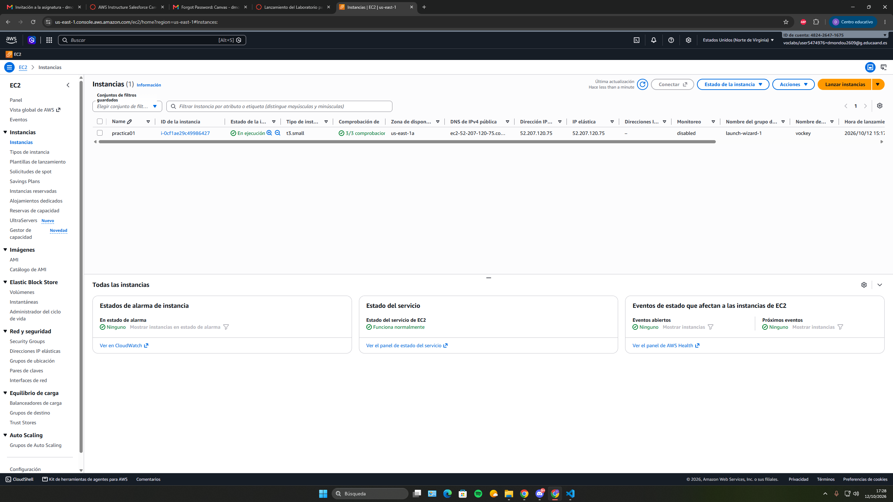

### Configuración del grupo de seguridad

Se han configurado las reglas de entrada para permitir conexiones SSH (22), HTTP (80) y HTTPS (443).

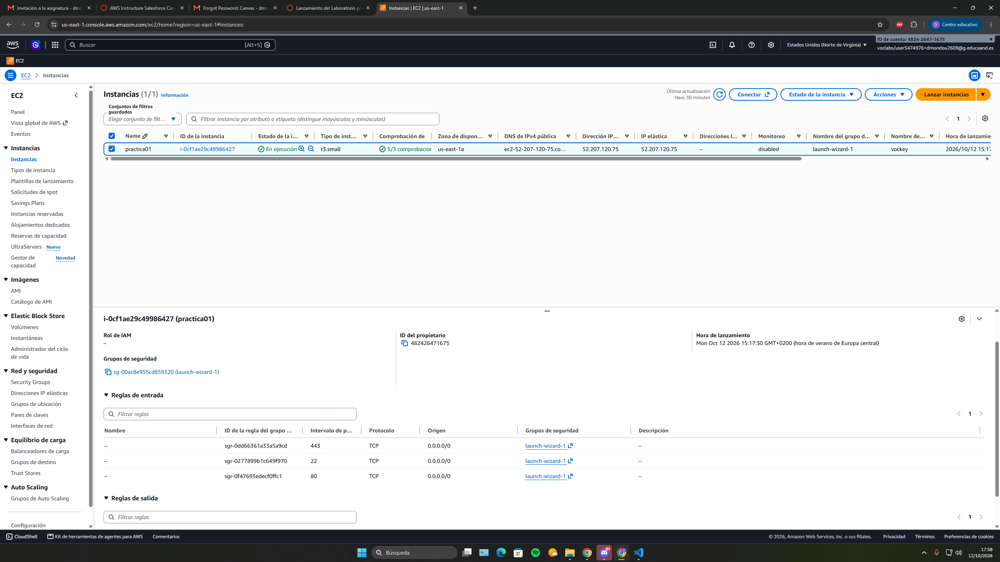

### Comprobación del acceso mediante la IP elástica

Se ha comprobado que el servidor web es accesible desde Internet mediante la dirección IP elástica asignada a la instancia EC2.

Al acceder a `http://52.207.120.75`, Apache ejecuta correctamente el archivo `index.php`, mostrando la información de PHP.

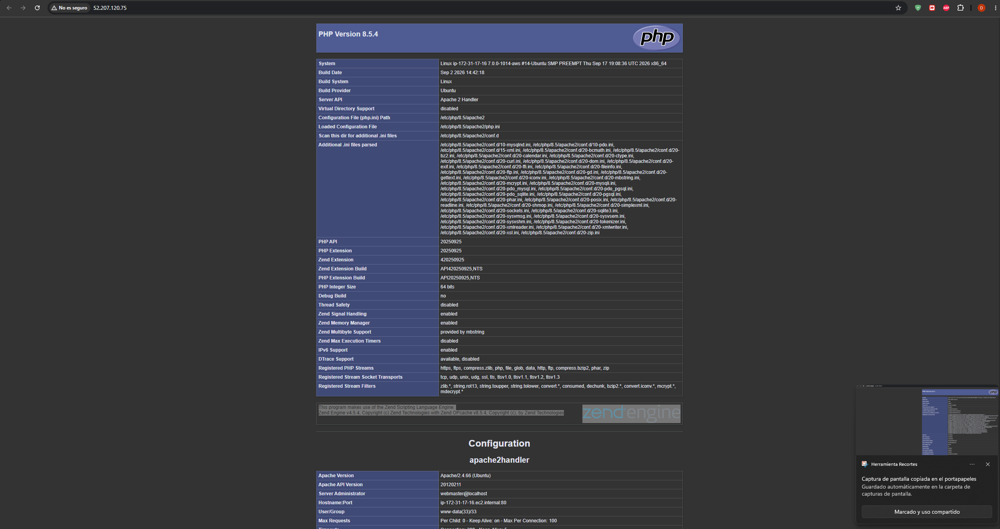

## 3. Instalación de Apache

Para instalar Apache se utiliza el siguiente comando:

```bash
sudo apt install apache2 -y
```

Se ha copiado el archivo `000-default.conf` para configurar el VirtualHost de Apache.

También se ha habilitado el módulo rewrite:

```bash
sudo a2enmod rewrite
```

Para comprobar la instalación:

```bash
apache2 -v
sudo systemctl status apache2
```

El servicio aparece como `active (running)`.

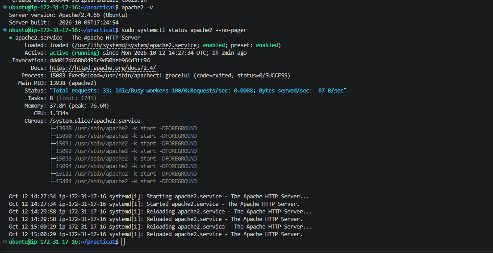

## 4. Instalación de PHP

Para instalar PHP y los módulos necesarios para Apache y MySQL se utiliza:

```bash
sudo apt install php libapache2-mod-php php-mysql -y
```

Se ha utilizado un archivo `index.php` con la función:

```php
<?php
phpinfo();
?>
```

Esta función permite comprobar que Apache interpreta PHP correctamente. Se debe retirar de la web pública después de realizar la prueba.

Para comprobar la versión instalada:

```bash
php -v
```

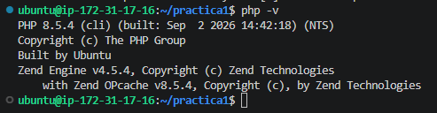

## 5. Instalación de MySQL

Para instalar MySQL Server se utiliza:

```bash
sudo apt install mysql-server -y
```

Durante la práctica, MySQL presentó un problema con los archivos de InnoDB, por lo que se realizó una copia de seguridad y se inicializó de nuevo su directorio de datos.

Una vez solucionado, se comprobó el estado:

```bash
sudo systemctl status mysql
```

El resultado fue `active (running)`.

También se configuró una contraseña para el usuario root y se creó una base de datos de prueba llamada `practica_lamp`.

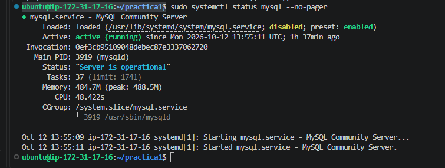

## 6. Instalación de phpMyAdmin

phpMyAdmin permite administrar bases de datos MySQL desde el navegador.

Se instalaron las extensiones necesarias:

```bash
sudo apt install php-mbstring php-zip php-gd php-curl php-xml -y
```

Después se instaló phpMyAdmin:

```bash
sudo apt install phpmyadmin -y
```

Se habilitó su configuración en Apache y se recargó el servicio.

Para comprobar su funcionamiento, se accedió mediante un túnel SSH a:

`http://localhost:8080/phpmyadmin/`

Se inició sesión con el usuario `usuario_lamp` y se comprobó que aparecía la base de datos `practica_lamp`.

Algunas funciones avanzadas de almacenamiento de configuración de phpMyAdmin quedaron pendientes de configurar.

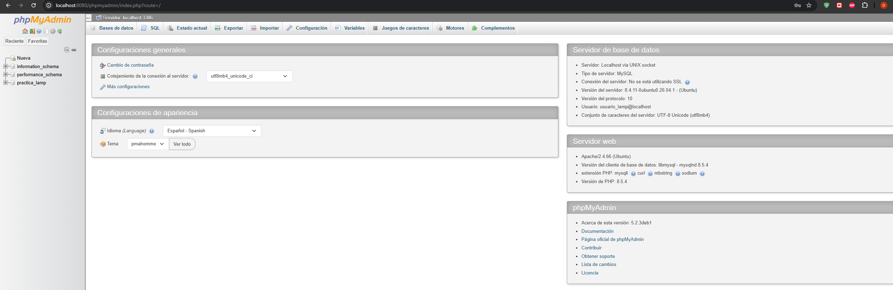

## 7. Instalación de Adminer

Adminer es otra herramienta de administración de bases de datos mediante una interfaz web.

Su instalación se realizó con:

```bash
sudo apt install adminer -y
```

Después se habilitó la configuración de Apache:

```bash
sudo a2enconf adminer
sudo systemctl reload apache2
```

Se comprobó su funcionamiento desde:

`http://localhost:8080/adminer/`

Se inició sesión utilizando el usuario `usuario_lamp` y se accedió a la base de datos `practica_lamp`.

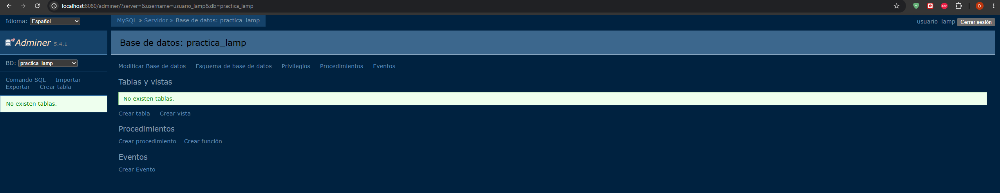

## 8. Instalación de GoAccess

GoAccess es una herramienta que permite analizar los registros de acceso de Apache.

Se instaló mediante:

```bash
sudo apt install goaccess -y
```

Se comprobó su versión:

```bash
goaccess --version
```

Para generar un informe HTML de los registros de Apache se utilizó:

```bash
sudo goaccess /var/log/apache2/access.log \
--log-format=COMBINED \
-o /home/ubuntu/informe_goaccess.html
```

El archivo generado se descargó y se abrió en el navegador.

El informe permite consultar el número de peticiones, visitantes, archivos solicitados y errores HTTP.

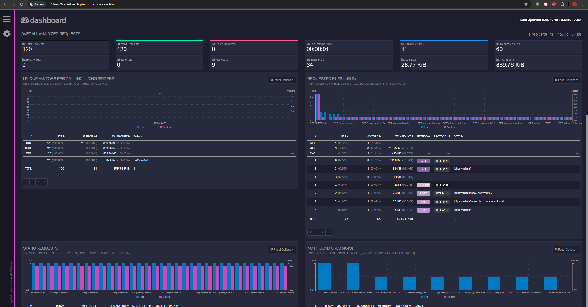

## 9. Control de acceso con .htaccess

Se ha configurado un directorio protegido mediante autenticación básica de Apache.

Primero se creó el directorio:

```bash
sudo mkdir -p /var/www/html/privado
```

Después se copió el archivo `.htaccess`, que contiene:

```apache
AuthType Basic
AuthName "Directorio protegido"
AuthUserFile /etc/apache2/.htpasswd
Require valid-user
```

Se creó el usuario `alumno` mediante:

```bash
sudo htpasswd -c /etc/apache2/.htpasswd alumno
```

Para comprobar la protección se ejecutó:

```bash
curl -I http://localhost/privado/
```

El servidor devolvió `401 Unauthorized`, indicando que se requiere autenticación.

Después se accedió a través del túnel SSH, introduciendo el usuario y la contraseña correctos.

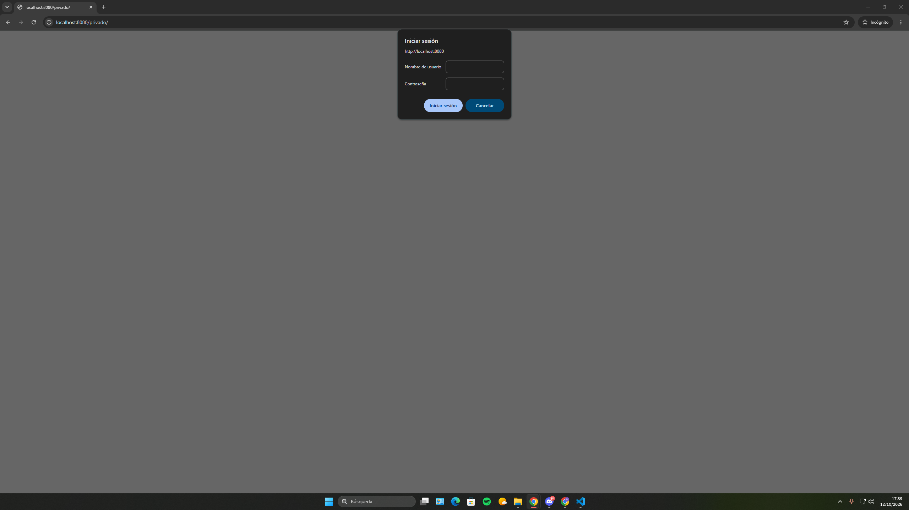

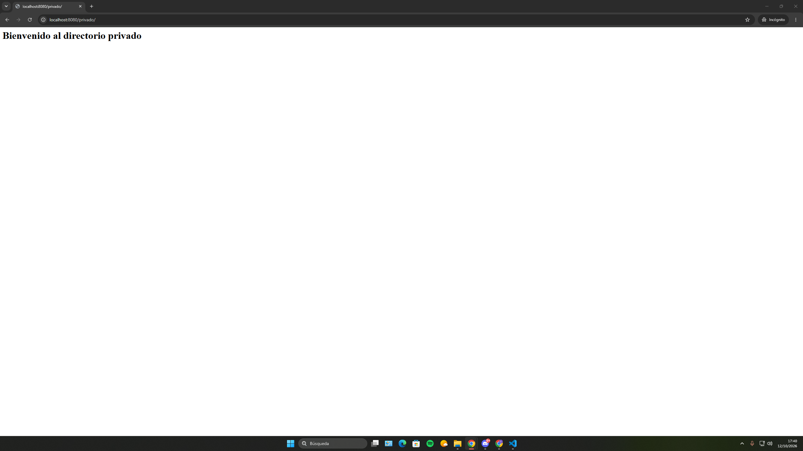

## 10. Automatización mediante scripts Bash

Se han utilizado dos scripts:

### install_lamp.sh

Automatiza la instalación de Apache, PHP y MySQL, así como la copia de los archivos de configuración necesarios.

### install_tools.sh

Automatiza la instalación de GoAccess, phpMyAdmin y Adminer, su integración con Apache y la preparación del directorio protegido mediante `.htaccess`.

### Archivo .env

Contiene las variables de configuración utilizadas por los scripts, como:

- WEB_DIR
- PRIVATE_DIR
- HTACCESS_USER
- DB_NAME
- DB_USER

No se deben almacenar contraseñas privadas en un repositorio público.

## 11. Conclusión

En esta práctica se ha desplegado una pila LAMP en Ubuntu Server utilizando una instancia EC2 de AWS.

Se ha comprobado el funcionamiento de Apache, PHP y MySQL, así como el acceso a phpMyAdmin y Adminer.

También se ha generado un informe de los registros de Apache utilizando GoAccess y se ha protegido un directorio mediante `.htaccess`.

Los scripts de Bash permiten automatizar gran parte de la instalación y configuración del servidor.
